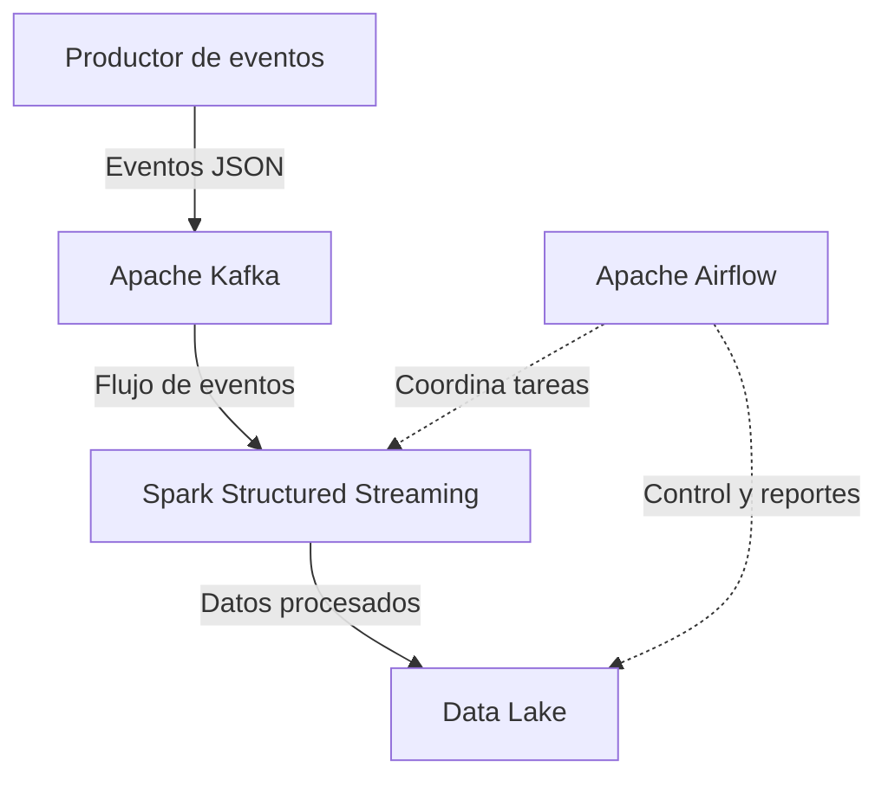

# Arquitectura del sistema — Cadena de frío

## 1. Objetivo

Diseñar un sistema de procesamiento de eventos para monitorear
las condiciones de transporte de productos sensibles a la temperatura.

## 2. Componentes principales

- Productor de eventos: simula las mediciones de los sensores.
- Apache Kafka: recibe y distribuye los eventos.
- Spark Structured Streaming: procesa y transforma los eventos.
- Data Lake: almacena los datos procesados.
- Apache Airflow: coordina tareas de validación y generación de reportes.

## 3. Flujo de datos

## 4. Funcionamiento general

El productor genera eventos simulados de temperatura y humedad
asociados a un vehículo o pedido.

Kafka recibe los eventos y los pone a disposición de Spark
Structured Streaming, que los valida y procesa.

Los resultados se almacenan en el Data Lake para su posterior
consulta y análisis.

Airflow coordina las tareas operativas y los controles definidos
para el proyecto.

## 5. Aspectos pendientes de definición

- Contrato JSON definitivo del evento.
- Validación de los KPI y umbrales de alerta.
- Formato y organización de los datos almacenados.
- Tareas específicas que coordinará Airflow.

## 6. Decisiones técnicas de Kafka

### 6.1. Tópico

Se propone utilizar el tópico `cadena_frio_eventos` para publicar los eventos generados durante el transporte de productos sensibles a la temperatura.

### 6.2. Clave del mensaje

Se propone utilizar `pedido_id` como clave del mensaje para agrupar los eventos de un mismo pedido en una misma partición y facilitar el procesamiento ordenado de sus eventos.

### 6.3. Número de particiones

Se propone comenzar con 3 particiones para distribuir los eventos y permitir el procesamiento en paralelo. Esta configuración inicial podrá ajustarse según el volumen de datos y los recursos disponibles.

### 6.4. Consumidor

Spark Structured Streaming consumirá los eventos de Kafka para validarlos, procesarlos y preparar los resultados que se almacenarán en el Data Lake.

